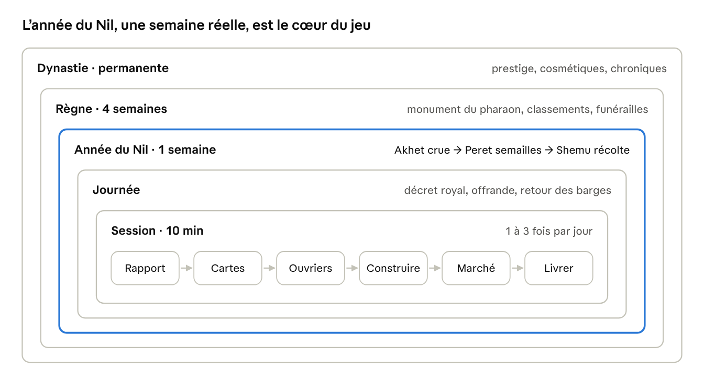

# Nomarque — Boucles de jeu & gestion (GDD v0.1)

> Source vivante : [document Claude](https://claude.ai/artifact/MSxBCyzAJhHd5BVmjarzny). Export du 15 novembre 2026.

## Vision et piliers

Tu es le nomarque d'une province (un nome) le long du Nil. Tu bâtis ta cité à la Pharaoh, mais personne ne peut tout produire seul : le multijoueur naît du commerce, du fleuve partagé et des chantiers du pharaon. Une saison = le règne d'un pharaon, environ 4 semaines.

Nom de travail : **Nomarque**.

**Les quatre piliers.** Chaque mécanique doit servir au moins un pilier, sinon elle sort du jeu.

1. **Chaque session de 10 minutes compte.** Le joueur prend des décisions, il ne fait pas de corvées. Pas de clic de récolte, pas de micro-gestion de porteurs d'eau.
2. **Personne ne peut tout faire seul.** Les ressources sont réparties par région et le stockage est limité. Commercer est plus rentable que tout produire.
3. **Le Nil donne le rythme.** Un cycle hebdomadaire prévisible (crue, semailles, récolte), avec un aléa : la hauteur de la crue.
4. **Rivaliser sans détruire.** Un autre joueur ne peut jamais raser ta cité. La compétition passe par le marché, la faveur royale et les classements.

**Ce qu'on garde de Pharaoh :** chaînes de production, maisons qui évoluent selon les besoins satisfaits, crue, monuments, dieux. **Ce qu'on jette :** walkers, temps réel, sessions longues, catastrophes pendant l'absence du joueur.

## Les boucles de jeu

Cinq boucles imbriquées : la session (10 min), la journée, l'année du Nil (1 semaine réelle), le règne (4 semaines) et la dynastie, qui persiste d'un règne à l'autre.

Chaque boucle s'emboîte dans la suivante : les sessions remplissent la journée, les journées suivent les phases du Nil, quatre crues font un règne.

### Boucle 1 — la session (5 à 15 min, 1 à 3 fois par jour)

1. **Lire le rapport de l'intendant** : production depuis la dernière visite, stocks pleins, contrats remplis, événements en attente.
2. **Trancher 1 à 3 cartes d'événement** : « Un scribe a détourné du grain ». Chaque carte offre 2 ou 3 choix avec un coût et une conséquence.
3. **Réaffecter la main-d'œuvre** entre champs, ateliers et chantiers. C'est le levier principal de la gestion.
4. **Construire ou améliorer** : placer un bâtiment, lancer une amélioration, mettre en file.
5. **Passer au marché** : vendre les surplus, acheter les manques, accepter ou poster un contrat.
6. **Livrer au pharaon** : commandes royales du jour, contribution au monument.

La session se termine naturellement quand les décisions sont prises. Le jeu n'invite jamais à rester connecté pour « optimiser ».

### Boucle 2 — la journée

- Un **décret royal du jour** : un objectif court (« livrer 200 pains », « atteindre 40 maisons de niveau 2 »), récompensé en faveur royale.
- Une **offrande au temple** : un choix de dieu par jour, donc une petite décision tactique.
- Le **retour des barges** : les marchandises envoyées la veille arrivent, avec un éventuel événement de voyage.

### Boucle 3 — l'année du Nil (1 semaine réelle)

C'est le cœur du jeu : chaque phase change ce qu'on fait et ce qui vaut cher.

| Phase | Durée réelle | Ce qui se passe | Décision clé |
| --- | --- | --- | --- |
| Akhet (crue) | lun. → mar. | Les champs sont inondés, les paysans sont libres. Annonce du Nilomètre (crue basse, bonne ou haute). | Envoyer les paysans à la corvée (monument, digues, bâtiments) ou les garder pour l'artisanat |
| Peret (semailles) | mer. → ven. | Les terres ressortent. On répartit les champs entre blé, orge, lin et papyrus, puis le choix est verrouillé. | Parier sur les cultures selon la crue annoncée et les prix attendus |
| Shemu (récolte) | sam. → dim. | Récoltes, pic du commerce, tribut dû au pharaon dimanche soir. | Vendre maintenant, stocker pour la semaine suivante, ou livrer au pharaon |

Le soir de l'annonce du Nilomètre (par exemple lundi 20 h) est un **rendez-vous fixe** : révélation en direct, envolée ou chute des prix, discussions sur Discord.

### Boucle 4 — le règne (4 semaines = 4 crues)

- **Semaine 1** : fondation. Le pharaon annonce son grand monument (pyramide, temple ou obélisques). Les nomes s'installent.
- **Semaines 2 et 3** : montée en puissance. Maisons de niveau 3 et 4, routes commerciales lointaines, commandes royales plus exigeantes.
- **Semaine 4** : dernier chantier du monument, puis mort du pharaon et funérailles (événement de clôture). Classements et titres.
- **Reset partiel** : la cité repart presque de zéro, la dynastie garde son prestige et ses cosmétiques.

### Boucle 5 — la dynastie (méta, permanente)

- Nom, blason et chroniques de la dynastie, conservés pour toujours (« sous le règne de Ramsès IV, la maison des Séthides fut la plus pieuse du Nil »).
- **Déblocages horizontaux**, jamais de puissance : nouveaux nomes de départ (delta, Haute-Égypte, oasis), styles architecturaux, dieux tutélaires.
- Les cosmétiques gagnés ou achetés suivent la dynastie de saison en saison.

## Le système de gestion

La gestion repose sur trois tensions : la terre fertile est rare, la main-d'œuvre est limitée, et les maisons réclament toujours plus. Chaque mécanique ci-dessous alimente l'une d'elles.

### La carte du nome

- Une carte découpée en 12 à 20 parcelles, avec trois zones : **Kemet**, la terre noire fertile le long du fleuve (rare), **Deshret**, le désert rouge (vaste, pour carrières, tombes, ateliers), et **le fleuve** (port, pêche, papyrus).
- La tension de base : chaque parcelle de terre noire occupée par une maison n'est plus un champ. Construire en hauteur dans le désert coûte de l'eau (canaux, puits).

### Les ressources et les chaînes de production

Trois niveaux. Chaque région du Nil ne produit qu'une partie des matières premières, ce qui force le commerce.

| Ressource | Niveau | Produite par | Sert à |
| --- | --- | --- | --- |
| Blé, orge | 1 | Champs (terre noire) | Pain, bière, tribut |
| Lin | 1 | Champs | Tissage |
| Papyrus | 1 | Marais (delta surtout) | Rouleaux, scribes |
| Argile, poisson | 1 | Rives | Poterie, briques, nourriture |
| Pierre calcaire, granit | 1 | Carrières (granit : Haute-Égypte) | Monuments, temples |
| Pain, bière | 2 | Boulangerie, brasserie | Besoins des maisons, ouvriers des chantiers |
| Poterie, briques crues | 2 | Potier, briqueterie | Maisons, stockage |
| Lin tissé, rouleaux | 2 | Tisserand, atelier de scribe | Maisons niv. 3, administration |
| Cuivre, cèdre, or, encens | Import | Expéditions (Sinaï, Byblos, Nubie, Pount) | Outils, navires, bijoux, rites |
| Bijoux, statues, encens brûlé | 3 | Orfèvre, sculpteur, temple | Villas (niv. 4), monuments, faveur des dieux |

Le stockage est limité par les greniers et entrepôts. Un surplus non vendu est perdu ou plafonné : il faut le vendre ou le livrer.

### Les maisons : le moteur de progression

La population vit dans des maisons qui montent de niveau quand leurs besoins sont couverts, comme dans Pharaoh. Une maison qui perd un besoin redescend, lentement et avec un avertissement.

| Niveau | Nom | Besoins | Ce qu'elle apporte |
| --- | --- | --- | --- |
| 1 | Hutte | Eau, une nourriture | Paysans |
| 2 | Maison | Deux nourritures, temple à portée, poterie | Plus d'impôts, artisans |
| 3 | Maison de scribe | Bière, lin tissé, école, marché local | Scribes (administration, contrats) |
| 4 | Villa | Bijoux, encens, divertissement, deux temples | Prêtres, prestige, gros impôts |

**Portée plutôt que walkers.** Un puits, un temple ou une école couvre sa parcelle et les parcelles voisines. Les maisons couvertes reçoivent le service. Le placement redevient un petit puzzle visuel, sans simulation de déplacements.

### La main-d'œuvre : le levier principal

- Quatre classes : **paysans**, **artisans**, **scribes**, **prêtres**. Chaque classe vient d'un niveau de maison.
- Les bâtiments demandent des travailleurs. Le joueur les répartit par curseurs, bâtiment par bâtiment ou par catégorie.
- **Pendant Akhet**, les champs sont inondés et les paysans sont libres. Les envoyer à la corvée fait avancer le monument et rapporte de la faveur, mais ils mangent sans produire de nourriture. C'est le grand arbitrage de début de semaine.
- Les scribes augmentent le nombre de contrats et de routes commerciales simultanés. Les prêtres améliorent la précision du Nilomètre et la faveur des dieux.

### La crue et le Nilomètre

- Chaque lundi, le Nilomètre annonce une crue **basse**, **bonne** ou **haute**.
- Crue basse : récoltes réduites, le grain vaut cher, les greniers pleins deviennent une richesse.
- Crue haute : risque d'inondation des bâtiments bas, sauf digues. Les terres sont plus fertiles ensuite.
- Avec assez de prêtres, un nome reçoit une **prévision anticipée** quelques heures avant les autres. C'est un avantage d'information, donc un vrai jeu de spéculation sur le marché.

### Les dieux

Cinq dieux, chacun avec une jauge de faveur alimentée par les offrandes et les temples.

| Dieu | Domaine | Bénédiction | Si on le néglige |
| --- | --- | --- | --- |
| Hâpy | La crue | Adoucit une mauvaise crue | Inondations plus graves |
| Osiris | Les récoltes | Meilleur rendement en Shemu | Champs moins fertiles |
| Thot | Le savoir | Plus de scribes, contrats moins chers | Erreurs administratives (cartes d'événement) |
| Bastet | Le foyer | Maisons plus contentes, montée de niveau plus rapide | Rongeurs dans les greniers |
| Sekhmet | La santé | Protège des épidémies | Épidémie (pertes de main-d'œuvre) |

Les conséquences négatives arrivent toujours sous forme de carte à trancher à la connexion suivante, jamais pendant l'absence.

### Les cartes d'événement

- 2 à 3 cartes par jour, tirées selon l'état de la cité (stocks, dieux négligés, phase du Nil).
- Chaque carte propose 2 ou 3 choix, avec un coût visible et parfois une conséquence différée.
- C'est là que vivent l'humour et la narration (un chat sacré coincé sur l'obélisque, un scribe qui falsifie les comptes). C'est aussi le contenu le moins cher à produire : du texte et une illustration.
- Les 30 cartes du MVP : [`data/economie/cartes.csv`](../data/economie/cartes.csv).

### Progression et titres

La **faveur royale** est la monnaie de prestige. Elle se gagne par le tribut, les commandes royales et le monument. Elle débloque des titres qui ouvrent de nouveaux bâtiments et droits.

Nomarque → Ami du roi → Porteur de l'éventail → Membre de la cour → Vizir (un ou deux par serveur).

## La couche multijoueur

Tout est asynchrone : on interagit avec ce que les autres ont fait, sans devoir être connectés en même temps. Le serveur est un seul Nil, avec 50 à 200 nomes alignés du sud (amont) au nord (aval).

### La géographie comme moteur d'échanges

- **Haute-Égypte (sud)** : granit, or de Nubie, peu de terres. **Moyenne-Égypte** : le grenier, beaucoup de blé. **Delta (nord)** : papyrus, bétail, vin, accès à Byblos.
- Le joueur choisit sa région au début du règne. Aucune région n'est autosuffisante pour atteindre la villa.
- **Le fleuve a un sens.** Les barges descendent vite vers le nord avec le courant, et remontent plus lentement vers le sud à la voile. Les délais créent des écarts de prix entre ports, donc des opportunités d'arbitrage.

### Le marché du Nil

- **Trois ports** (Thèbes, Memphis, un port du delta), chacun avec son carnet d'ordres par ressource. Monnaie : le **deben**.
- Ordres d'achat et de vente à prix limite, exécutés automatiquement. Pas besoin d'être connecté.
- **Les greniers royaux**, un acteur non joueur, achètent tout à un prix plancher et vendent à un prix plafond. Le marché n'est jamais vide, même avec 30 joueurs, et les prix ne peuvent pas exploser.
- Taxe de transaction faible, qui sert de puits de monnaie contre l'inflation.

### Les contrats entre joueurs

- « Livrer 500 pains à Memphis avant jeudi pour 40 deben ». L'acheteur bloque le paiement à la création, le vendeur est payé à la livraison.
- Un contrat non tenu coûte de la **réputation**, visible par tous. La réputation devient une ressource sociale.
- Le nombre de contrats simultanés dépend des scribes. Cela donne une raison de monter des maisons de niveau 3.

### Les commandes royales et le grand monument

- **Commandes du jour et de la semaine** : le pharaon demande des quantités précises (pierre, pain pour les ouvriers, lin). Chaque livraison rapporte de la faveur.
- **Le grand monument du règne** se construit avec les livraisons de tout le serveur, en 4 étapes, une par semaine. Chaque étape achevée donne un bonus à tous (par exemple +10 % de récolte la semaine suivante).
- Classement des contributeurs visible, avec les noms gravés dans le monument à la fin du règne.
- Si une étape n'est pas finie à temps, tout le serveur subit un malus. Cela crée une pression collective et des appels à l'aide sur le chat.

### Les confréries

- Groupes de 5 à 15 joueurs, dédiés à un dieu tutélaire.
- Un **grenier commun** (dons entre membres, plafonnés pour limiter les abus), des commandes de confrérie, et un **temple de confrérie** construit ensemble.
- Des membres répartis sur plusieurs régions sont avantagés. La géographie pousse donc des confréries mixtes.

### La cour du pharaon : la politique

- Chaque semaine, les nomarques les plus en faveur forment la cour.
- Le **vizir** (le premier en faveur) choisit le décret de la semaine parmi trois propositions, par exemple « corvée doublée pour le monument », « taxe sur l'encens », « ouverture d'une route vers Pount ».
- Le décret change les règles pour tout le serveur pendant 7 jours. Cela crée des alliances, du lobbying et des discussions sans aucun combat.

### Les interactions hostiles, sous contrôle

- **Espionnage** : voir les stocks ou les ordres d'un rival.
- **Rumeurs** : faire baisser la faveur d'un rival auprès du pharaon.
- **Sabotage d'une barge** : retarder une livraison, sans la détruire.
- Chaque action coûte cher, est limitée par semaine, peut être contrée (gardes, prêtres) et peut être découverte, ce qui coûte de la réputation.
- Aucune action ne détruit un bâtiment ni ne vole des ressources stockées.

### Plus tard : le Nil partagé

Les nomes en amont pourraient construire des bassins de rétention qui réduisent la crue en aval. C'est très riche (traités sur l'eau, tensions) mais aussi très propice à la nuisance. À tester seulement après le MVP, avec un plafond strict.

## Ce qui rend le jeu drôle et engageant

Le plaisir vient de six sources. Chacune correspond à des mécaniques précises : si une source manque en test, on sait quoi renforcer.

| Source de plaisir | Mécaniques qui la portent | Quand le joueur la ressent |
| --- | --- | --- |
| Le pari | Répartition des cultures en Peret, spéculation sur la crue, stockage avant une crue basse | Lundi soir à l'annonce du Nilomètre, dimanche à la récolte |
| Voir sa cité grandir | Montée des maisons de hutte à villa, styles architecturaux, monuments personnels | À chaque connexion, et à chaque capture d'écran partagée |
| Le bon coup commercial | Arbitrage entre ports, contrat juteux, revente d'encens avant un décret | Quand un ordre s'exécute pendant l'absence du joueur |
| L'œuvre collective | Monument du règne, temple de confrérie, commandes royales | À chaque étape achevée et aux funérailles du pharaon |
| Le statut | Titres, cour, vizir, noms gravés, chroniques de dynastie | Fin de semaine et fin de règne |
| L'histoire et l'humour | Cartes d'événement, chroniques, décrets absurdes du pharaon | 2 à 3 fois par jour |

### Les moments forts à soigner

1. **La lecture du Nilomètre** (lundi soir) : révélation animée, prix qui bougent en direct, le chat qui s'emballe.
2. **La première villa** : une animation, une notification à la confrérie, un nouveau bâtiment débloqué.
3. **L'étape du monument achevée** : tout le serveur reçoit le bonus en même temps.
4. **Les funérailles du pharaon** : cortège, classements, noms gravés, chronique du règne générée et partageable.

### Plusieurs façons de gagner

Un seul classement décourage la plupart des joueurs dès la deuxième semaine. On en propose plusieurs, chacun avec son titre de fin de règne : le plus riche, le plus pieux, le plus grand bâtisseur, le meilleur marchand, le plus fiable (réputation), la plus belle cité (vote des joueurs), la meilleure progression (pensé pour les retardataires).

### Les profils de joueurs servis

- **Le bâtisseur** : optimise sa cité, vise la villa et la beauté.
- **Le marchand** : vit sur le marché, les contrats et l'arbitrage.
- **Le courtisan** : vise la faveur, la cour, le vizirat.
- **Le collectif** : porte sa confrérie et le monument.

Chaque profil doit pouvoir finir un règne avec un titre.

## Densité de jeu

Le risque n'est pas d'avoir peu de temps de jeu, c'est d'avoir peu de décisions intéressantes. Chaque session doit en proposer au moins une, sans corvée.

### Le creux de Peret

Du mercredi au samedi, les cultures sont verrouillées et la récolte n'est pas là. Sans contenu dédié, ce sont trois jours vides par semaine. On les remplit avec :

- **Des événements de milieu de semaine** : criquets, sécheresse partielle, fête d'Opet (bonus de bonheur contre de la bière), caravane de passage avec des offres rares pendant quelques heures.
- **Les expéditions** : envoyer une barge, choisir une route plus ou moins risquée, découvrir le résultat un ou deux jours plus tard.

### Les règles

1. **Une décision garantie par session** : carte d'événement, opportunité de marché ou commande royale urgente. Si l'intendant a tout géré, il le dit en une ligne.
2. **Plancher bas, plafond haut** : 10 minutes suffisent, mais le marchand ou l'aménagiste peut jouer bien plus longtemps s'il le souhaite.
3. **Le social comme contenu** : demandes d'aide de la confrérie, lobbying auprès du vizir, monument en retard.
4. **Pas de faux contenu** : ni clic de récolte, ni jauge d'énergie, ni coffre quotidien sans choix.

### À mesurer en bêta

- Le nombre de sessions par joueur et par jour.
- La part de sessions avec au moins une décision prise. Trop basse : le jeu est vide.
- La durée des sessions. Bien au-delà de 15 minutes pour un joueur moyen : le jeu devient une corvée.

## Fin de règne et passage au suivant

Un règne dure 4 années du Nil. Le suivant démarre sans interruption, au lundi 20 h suivant, avec l'annonce de la première crue.

### Les funérailles du pharaon

- Elles occupent les 24 dernières heures de jeu de l'année 4 (de l'heure 144 à 168 de Shemu).
- Le marché et les contrats ferment. Seules restent possibles les dernières livraisons au monument et la consultation des classements.
- À l'heure 168 : tous les nomes sont avancés une dernière fois, les ordres et contrats ouverts sont annulés et remboursés, puis les classements sont figés.
- Une **chronique du règne** est générée pour chaque dynastie et pour le serveur, partageable sous forme d'image.

### Ce qui est remis à zéro

La cité entière : parcelles, bâtiments, maisons, stocks, deben, faveur royale, réputation, confrérie (à refonder ou à reconduire en un clic).

### Ce qui persiste avec la dynastie

| Élément | Comment il évolue |
| --- | --- |
| Nom, blason, portrait | Choisis par le joueur |
| Prestige | Points gagnés selon le rang dans chaque classement et la contribution au monument |
| Titres de fin de règne | Gravés dans les chroniques, affichés sur le profil |
| Cosmétiques | Gagnés ou achetés, utilisables à chaque règne |
| Badge de fiabilité | Si la réputation finale dépasse un seuil |

**Aucune puissance ne se transmet.** Le prestige débloque des cosmétiques et des nomes de départ au style différent, jamais une production ou un stock supérieur.

### Arriver en cours de règne

- Inscription ouverte jusqu'à la fin de l'année 3. Pendant l'année 4, le joueur s'inscrit pour le règne suivant et peut suivre le serveur en spectateur.
- **Rattrapage :** production ×1,5 tant que la population du nome est sous la médiane du serveur.
- Un retardataire concourt dans tous les classements. Le classement « meilleure progression » lui donne une vraie chance de titre.

### Les nomes inactifs

- Sans connexion pendant 7 jours réels, un nome est marqué abandonné. Il ne compte plus dans le calcul des objectifs du monument et des commandes royales.
- Il reste consultable et reprend normalement si le joueur revient.

### Bascule technique

Création du règne suivant, tirage à l'avance de ses 4 crues, application de la nouvelle version des données d'équilibrage, choix du nouveau monument.

## Onboarding : les 10 premières minutes

Le joueur apprend en faisant, guidé par Méri, la scribe du nome. Aucune fenêtre de plus de deux lignes, et chaque étape se termine par une action du joueur.

### Au départ

- **Choix de la région** : trois cartes (Haute-Égypte, Moyenne-Égypte, Delta), une phrase chacune sur ce qu'elle produit bien.
- **Nom de dynastie** : proposé automatiquement, modifiable.
- **Cité de départ déjà vivante** : 3 huttes, 1 champ de blé, 1 puits, 1 grenier. Le joueur voit tout de suite quelque chose qui tourne.

### Les cinq missions guidées

| # | Mission | Ce que le joueur apprend | Durée |
| --- | --- | --- | --- |
| 1 | Construire un deuxième champ sur une parcelle libre | Les parcelles et les zones | 1 min |
| 2 | Affecter des ouvriers avec le curseur et voir la prévision changer | La main-d'œuvre, le levier principal | 1 min |
| 3 | Trancher une première carte : un chat sacré dort sur le grenier | Les choix et leurs conséquences | 1 min |
| 4 | Vendre le surplus de blé aux greniers royaux | Le marché, les premiers deben | 2 min |
| 5 | Construire une boulangerie | Les chaînes de production (blé → pain) | 2 min |

Les constructions des missions sont accélérées (une minute réelle) pour garder le rythme.

### La sortie du tutoriel

1. Un écran unique explique où en est le cycle du Nil et quand tombe la prochaine crue.
2. Méri présente la commande royale du jour, premier vrai objectif.
3. Proposition d'activer les notifications, avec une raison concrète : « On te prévient lundi soir pour la crue. »

### Règles

- Un joueur qui a déjà une dynastie saute le tutoriel.
- Chaque mission peut être passée.
- À mesurer : la part de nouveaux joueurs qui terminent les cinq missions, et la part qui revient le lendemain.

## Équité, asynchrone et anti-frustration

La règle : le joueur ne doit jamais avoir peur de se déconnecter, ni l'impression qu'il a perdu d'avance.

### Respecter l'absence

- La production continue hors ligne, plafonnée par le stockage. On ne perd rien à ne pas venir pendant 12 heures, on gagne juste moins au-delà.
- Aucun événement négatif ne se résout sans le joueur : il attend sous forme de carte, avec un délai de grâce (par exemple 24 h avant un choix par défaut raisonnable).
- **L'intendant** : règles simples paramétrables (« vendre le blé au-delà de 80 % du grenier », « livrer automatiquement à la commande royale »). Gratuit et complet, pour que jouer une fois par jour reste viable.
- Les notifications (PWA) se limitent aux moments utiles : Nilomètre, contrat rempli, étape du monument.

### Rester dans la course

- Les saisons de 4 semaines limitent l'avance des vétérans. Un nouveau joueur attend au pire quelques jours le prochain règne.
- **Rattrapage** pour qui arrive en cours de règne : production accélérée jusqu'au niveau médian du serveur.
- Les bonus de dynastie sont horizontaux (choix, styles), jamais une puissance de départ supérieure.
- Les classements multiples (section précédente) laissent une victoire possible à chaque profil.

### Protéger l'économie

- **Serveur autoritaire** : tout calcul de production, de transport et de marché se fait côté serveur. Le client ne fait qu'afficher et envoyer des intentions.
- **Multicompte** : transferts plafonnés entre comptes récents, détection des échanges à sens unique, contrats à prix aberrant bloqués.
- **Manipulation de marché** : bandes de prix autour du cours, plafond d'ordres par joueur, greniers royaux qui amortissent les extrêmes.
- **Inflation** : puits de deben (taxe de marché, entretien des bâtiments, offrandes, monuments) à surveiller avec des métriques dès la bêta.
- **Bots** : limites de fréquence par action. Comme l'intendant fait déjà l'essentiel des automatismes, un bot apporte peu.

### Tester l'équilibrage avant les joueurs

Simuler un règne complet avec des joueurs scripts (un marchand, un bâtisseur, un passif). Si le passif finit loin derrière mais pas humilié, et si aucune stratégie unique ne domine, l'économie tient.

## Monétisation compatible

Le principe : on vend du prestige, du style et du confort non compétitif, jamais des ressources, de la vitesse ou de la puissance. Un joueur gratuit doit pouvoir devenir vizir.

| Offre | Contenu | Pourquoi ça marche ici |
| --- | --- | --- |
| Pass de règne (gratuit + premium) | Paliers gagnés en jouant : styles de bâtiments, statues, barges décorées, titres de chronique | Le règne de 4 semaines donne un rythme naturel au pass |
| Cosmétiques de dynastie | Blason, portrait du nomarque, bannières, monument personnel décoratif | Ils suivent la dynastie de saison en saison, donc l'achat dure |
| Styles architecturaux | Ancien Empire, Nouvel Empire, Amarna, nubien… | La cité est faite pour être regardée et partagée |
| Abonnement « Scribe royal » (optionnel) | Historique de prix détaillé, planificateur de cité, chroniques enrichies, emplacement de cité de test | Confort et analyse, sans production en plus |

**À ne jamais vendre :** ressources, deben, accélération de construction, main-d'œuvre, faveur royale, protection contre les rumeurs ou le sabotage.

**Zone grise à trancher :** l'historique de prix détaillé donne un petit avantage d'information aux marchands. Option : le rendre gratuit avec 24 h de retard, et en temps réel pour les abonnés.

## Périmètre MVP, risques et questions ouvertes

Le MVP doit prouver une seule chose : un règne de 4 semaines avec 30 à 60 joueurs est amusant, et les joueurs reviennent pour le suivant.

### Dans le MVP

- Un serveur, une région de départ par joueur parmi trois.
- 19 bâtiments, 13 ressources et 4 importées, maisons de niveau 1 à 3 (la villa vient après).
- Le cycle du Nil complet avec le Nilomètre.
- Marché à un seul port avec greniers royaux, plus les contrats simples.
- Commandes royales et monument du règne.
- Une trentaine de cartes d'événement, cinq dieux.
- L'intendant en version simple.
- Des expéditions simples : 4 destinations, 2 routes chacune (elles remplissent le creux de Peret).

### Plus tard

Confréries, cour et vizir, plusieurs ports et transport fluvial, interactions hostiles, Nil partagé, monétisation.

### Piste technique

Voir [`spec-technique.md`](spec-technique.md).

- **NestJS** (TypeScript) pour l'API et les règles, avec PostgreSQL. Même architecture qu'Angular : modules, injection de dépendances, décorateurs.
- **Production calculée à la demande** : on stocke l'état et l'horodatage, et on recalcule à la lecture. Pas de tick global qui met à jour 200 cités chaque minute.
- **BullMQ (files de tâches sur Redis)** pour les échéances (fin de construction, arrivée de barge, changement de phase du Nil, exécution des ordres).
- **WebSockets (passerelle WebSocket de NestJS)** pour pousser les événements en direct (Nilomètre, prix, monument).
- Front : PixiJS ou Phaser pour la carte, le reste de l'interface en Angular. PWA pour le mobile et les notifications.
- **Monorepo Nx** : les règles du jeu (production, coûts, formules) dans une librairie TypeScript partagée entre serveur et client. Le client affiche des prévisions exactes, le serveur reste l'autorité.

### Risques principaux

| Risque | Impact | Parade |
| --- | --- | --- |
| Masse critique au lancement | Marché vide, serveur sans vie | Greniers royaux, petit serveur, monument dimensionné selon le nombre de joueurs |
| Équilibrage économique | Inflation, stratégie unique dominante | Simulation par joueurs scripts, métriques dès la bêta, saisons qui permettent de corriger |
| Coût graphique | Le poste le plus lourd en solo | Direction artistique sobre et stylisée, peu de bâtiments mais très lisibles, niveaux de maison par variations |
| Rétention après la semaine 1 | Le joueur a vu toute la boucle | Montée des maisons, décrets, monument, objectifs de fin de règne |
| Session qui devient une corvée | Abandon | Intendant gratuit, cartes d'événement à durée de vie limitée, pas de clic de collecte |

### Décisions prises

- **Mobile d'abord.** L'interface de session (rapport, cartes, ouvriers, marché) est conçue pour le téléphone, l'ordinateur affiche la même chose en plus grand. PWA pour la bêta, puis Capacitor pour publier sur iOS et Android.
- **Cité en parcelles, pas en grille libre.** 12 à 20 parcelles par nome, chacune accueille un bâtiment ou un îlot de maisons. On tape une parcelle et on choisit quoi y mettre. Moins d'assets à produire.
- **Serveur conçu pour 20 à 150 joueurs actifs.** Les greniers royaux font vivre le marché dès 20 joueurs, et les objectifs du monument et des commandes royales se calculent selon le nombre d'actifs. Au-delà de 150, un deuxième Nil ouvre au règne suivant. Première bêta : viser 30 à 50 joueurs.
- **Rythme réglable.** Un paramètre de vitesse dans la config du serveur : 1 année du Nil = 1 jour en tests internes, 3 ou 4 jours en bêta fermée, 1 semaine au lancement. Toutes les durées (constructions, barges, phases) sont exprimées en fractions d'année, jamais en heures.

### Questions ouvertes

- [ ] Nom définitif du jeu ? En attendant, nom de projet : Nomarque.
