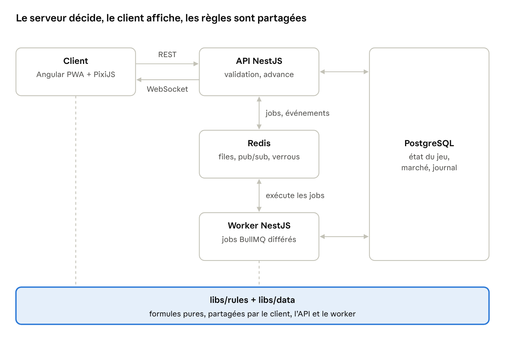
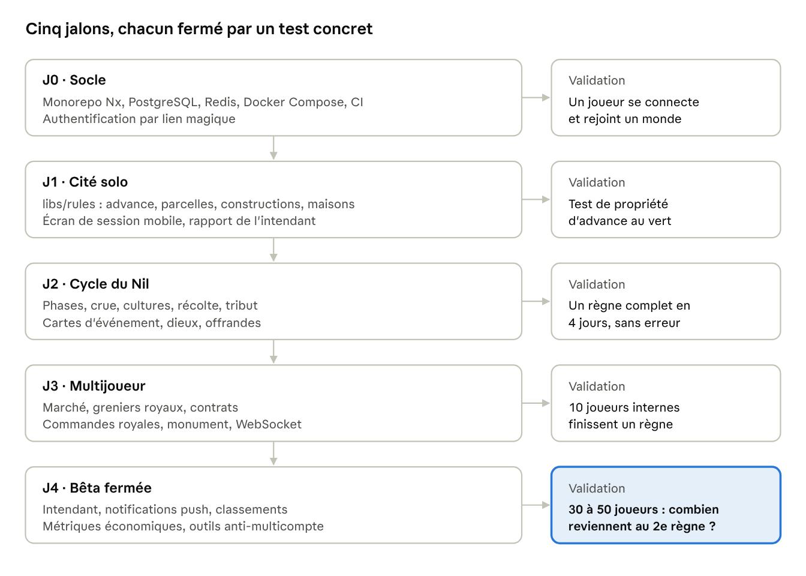

# Nomarque — Spec technique MVP

> Source vivante : [document Claude](https://claude.ai/artifact/NBmTQeeKnEpkcEwTVjF6Z3). Export du 15 novembre 2026.

## Stack et architecture

TypeScript partout, dans un monorepo Nx. Le serveur fait autorité sur tout calcul ; le client affiche et envoie des intentions. Les chiffres viennent du tableur d'économie (copie dans [`data/economie`](../data/economie)).

| Brique | Choix | Rôle |
| --- | --- | --- |
| `apps/web` | Angular + PixiJS, PWA | Interface de session, carte des parcelles, notifications |
| `apps/api` | NestJS | API REST, authentification, validation des actions |
| `apps/worker` | NestJS + BullMQ | Échéances : constructions, barges, phases du Nil, contrats |
| `libs/rules` | TypeScript pur, sans dépendance | Formules de production, coûts, besoins, temps du jeu |
| `libs/data` | JSON versionné | Bâtiments, ressources, maisons, cartes (export du tableur) |
| `libs/contracts` | Types TypeScript | DTO et événements partagés entre client et serveur |
| Base | PostgreSQL + Prisma | État du jeu, marché, journal des actions |
| Cache et files | Redis | Files BullMQ, verrous, diffusion des événements |
| Temps réel | Passerelle WebSocket NestJS (Socket.IO) | Nilomètre, prix, contrats remplis, monument |



Le client parle à l'API en REST et reçoit les événements par WebSocket. L'API et le worker échangent via Redis, jamais directement.

Déploiement du MVP : un seul serveur avec Docker Compose (api, worker, postgres, redis, front statique). `apps/api` et `apps/worker` partagent le même code métier et se séparent plus tard si la charge l'exige.

**Règle d'or :** `libs/rules` ne lit ni la base ni l'horloge. Elle reçoit un état et un instant, et rend un nouvel état. Elle se teste donc en unitaire, et le client l'utilise pour afficher des prévisions exactes.

## Modèle de données

Quinze entités pour le MVP. Les données de jeu fixes (types de bâtiments, ressources, cartes) ne sont pas en base : elles vivent dans `libs/data` et sont référencées par leur identifiant texte (`farm_wheat`, `bread`…).

| Entité | Champs clés | Notes |
| --- | --- | --- |
| `Player` | id, email, displayName, createdAt | Compte joueur |
| `Dynasty` | id, playerId, name, prestige, cosmetics | Persiste d'un règne à l'autre |
| `World` | id, name, speed, status, createdAt | Un serveur = un Nil. `speed` = années par semaine réelle |
| `Reign` | id, worldId, number, startsAt, endsAt, monumentProgress | Une saison de 4 années du Nil |
| `NileYear` | id, reignId, index, floodLevel, revealedAt | Crue tirée à l'avance, révélée au début d'Akhet |
| `Nome` | id, reignId, dynastyId, region, deben, favor, reputation, **computedAt** | Une cité pour un règne. `computedAt` = dernier calcul de production |
| `Parcel` | id, nomeId, slot, zone, buildingType, houseLevel, workers, buildEndsAt | 12 à 20 par nome. Soit un bâtiment, soit un îlot de maisons, soit vide |
| `Stock` | nomeId, resource, quantity | Clé composée. Capacité calculée depuis les greniers |
| `MarketOrder` | id, worldId, port, nomeId, resource, side, quantity, remaining, unitPrice, status, createdAt | Ordre à prix limite |
| `Trade` | id, buyOrderId, sellOrderId, quantity, unitPrice, executedAt | Historique des prix |
| `Contract` | id, issuerNomeId, takerNomeId, resource, quantity, totalPrice, deadline, status | Paiement bloqué à la création |
| `RoyalOrder` | id, reignId, resource, target, delivered, favorPerUnit, endsAt | Commandes du jour et de la semaine, monument |
| `EventCardDraw` | id, nomeId, cardId, drawnAt, expiresAt, choice, resolvedAt | Choix par défaut appliqué à l'expiration |
| `Expedition` | id, nomeId, destination, route, cost, departsAt, returnsAt, outcome, claimedAt | Issue tirée au départ (générateur initialisé par l'id), révélée au retour |
| `ActionLog` | id, nomeId, type, payload, createdAt | Toute action joueur, pour l'anti-triche et le débogage |

**Concurrence :** chaque action sur un nome se fait dans une transaction qui verrouille la ligne `Nome` (`SELECT … FOR UPDATE`). Le calcul de production, l'action et la mise à jour de `computedAt` sont atomiques.

## Le temps du jeu

Toutes les durées sont en **heures de jeu** : une année du Nil dure 168 heures de jeu. La vitesse du serveur les convertit en temps réel, ce qui permet de tester un règne en 4 jours sans toucher au code.

Le temps de jeu écoulé depuis le début du règne, en heures de jeu :

```
T = Δt (heures réelles) × speed
```

Avec `speed` = 1 au lancement (1 année = 1 semaine), 3 à 4 en bêta et 7 en tests internes (1 année = 1 jour). L'année courante est `floor(T / 168)`, et la position dans l'année est `T mod 168`.

| Phase | Heures de jeu dans l'année | Au lancement | Ce qui change |
| --- | --- | --- | --- |
| Akhet (crue) | 0 → 48 | lundi 0 h → mercredi 0 h | Champs inondés, ouvriers des champs libres, crue révélée à l'heure 0 |
| Peret (semailles) | 48 → 120 | mercredi → samedi | Choix des cultures verrouillé à l'heure 48 |
| Shemu (récolte) | 120 → 168 | samedi → lundi | Récolte à l'heure 120, tribut prélevé à l'heure 166 |

L'heure de révélation du Nilomètre (lundi 20 h) s'obtient en réglant `startsAt` du règne sur un lundi 20 h.

Fonctions de `libs/rules` :

- `gameHours(reign, now)` : le temps de jeu écoulé.
- `phaseAt(gameHours)` : la phase et l'année.
- `nextBoundary(gameHours)` : la prochaine frontière de phase, pour planifier les tâches.
- `toRealMs(gameHoursDuration, speed)` : une durée de jeu convertie en millisecondes réelles.

## Production calculée à la demande

Aucun tick global. Chaque nome stocke son état et `computedAt`. À chaque lecture ou action, le serveur appelle `advance(state, from, to)` de `libs/rules`, enregistre le nouvel état, puis applique l'action.

### L'algorithme `advance`

1. **Découper** l'intervalle aux frontières : phases du Nil, heure de récolte (120), tribut (166), fins de construction. Puis en segments alignés sur une grille fixe de 6 heures de jeu, pour que le découpage ne dépende pas de l'heure de connexion.
2. **Pour chaque segment**, dans cet ordre :
   1. Main-d'œuvre : ouvriers disponibles par classe selon les maisons. Si les affectations dépassent l'offre, toutes sont réduites au même prorata.
   2. Matières premières (niveau 1, hors champs) : production continue.
   3. Ateliers (niveau 2), du plus simple au plus transformé : consomment leurs entrées et produisent, limités par le stock disponible.
   4. Maisons : consomment leurs besoins. Les besoins non couverts sont notés.
   5. Impôts : ajoutés aux deben.
   6. Stockage : plafonné par les greniers, l'excédent est perdu et noté dans le rapport.
3. **Aux frontières** : récolte des champs à l'heure 120, tribut à l'heure 166, bâtiment livré en fin de construction.
4. **Rendre** le nouvel état et un rapport (produit, consommé, perdu, besoins manquants) pour l'écran de l'intendant.

### Les formules

Un atelier sur un segment de durée Δh, avec un taux d'occupation s (ouvriers affectés / ouvriers requis, plafonné à 1) :

```
produit = (sortie_an / 168) × Δh × s × k
k       = min(1, stock_entrée / ((entrée_an / 168) × Δh × s))
```

Un champ ne produit qu'à la récolte, selon l'occupation moyenne pendant Peret et le multiplicateur de crue :

```
récolte = sortie_an × s̄_Peret × m_crue
```

Pendant Akhet, les ouvriers des champs sont libres et peuvent être envoyés à la corvée.

### Les maisons

- Une maison dont tous les besoins sont couverts pendant 24 heures de jeu monte d'un niveau, si la parcelle le permet.
- Un besoin manquant pendant 24 heures de jeu déclenche un avertissement, et pendant 48 heures une descente de niveau. Cette hystérésis évite les montagnes russes.
- Les services (eau, temple, école, marché) sont vérifiés par portée : parcelle du service et parcelles voisines.

### Pourquoi c'est sûr

`advance` est une fonction pure et déterministe : même état et même intervalle donnent le même résultat. Un test de propriété vérifie que `advance(a→c)` égale `advance(b→c)` appliqué après `advance(a→b)`, à l'arrondi près. Sans cette propriété, un joueur qui se connecte souvent gagnerait plus qu'un joueur qui se connecte peu.

## Échéances et tâches planifiées

Principe : une tâche planifiée n'est jamais la seule source de vérité. L'état d'un nome se déduit toujours du temps (section précédente). Les tâches servent à trois choses : régler ce qui concerne plusieurs joueurs, notifier, et tenir les classements à jour.

| Tâche | Quand | Ce qu'elle fait | Clé d'idempotence |
| --- | --- | --- | --- |
| `nile.phase` | Chaque frontière de phase | Publie la crue (Akhet), verrouille les cultures (Peret), notifie la récolte (Shemu) | `reignId:année:phase` |
| `reign.end` | Fin de la 4e année | Calcule tous les nomes, classements, funérailles, prestige des dynasties | `reignId` |
| `royal.rotate` | Chaque jour de jeu (24 h de jeu) | Ferme les commandes royales échues, en ouvre de nouvelles | `reignId:jour` |
| `contract.deadline` | À l'échéance d'un contrat | Rembourse l'acheteur si non livré, retire de la réputation au vendeur | `contractId` |
| `build.done` | Fin d'une construction | Notification seulement : la production se calcule d'elle-même | `parcelId:buildEndsAt` |
| `granary.refill` | Toutes les 6 h de jeu | Recharge les ordres des greniers royaux au plancher et au plafond | `worldId:créneau` |
| `expedition.return` | Au retour d'une barge | Notifie le joueur. La cargaison est créditée quand il ouvre le résultat | `expeditionId` |
| `ranking.snapshot` | Toutes les heures réelles | Avance tous les nomes et fige les classements | `reignId:heure` |

- Les tâches sont des jobs BullMQ différés, calculés avec `toRealMs` et la vitesse du serveur.
- **Au démarrage du worker**, une réconciliation recrée les jobs manquants à partir des règnes, contrats et constructions en base. Un redémarrage ou une perte de Redis ne casse donc rien.
- **Les cartes d'événement** ne sont pas des jobs : elles sont tirées dans `advance`, avec un générateur pseudo-aléatoire initialisé par `nomeId` et le créneau de jeu. Le tirage est reproductible et ne dépend pas de l'heure de connexion.

## Marché, greniers royaux et contrats

Un seul port pour le MVP. Un carnet d'ordres par ressource, avec la priorité prix puis ancienneté. Tout règlement se fait dans une seule transaction PostgreSQL.

### Placer un ordre

1. Avancer le nome (`advance`) pour avoir des stocks à jour.
2. Vérifier le prix : il doit être entre le plancher et le plafond de la ressource. Hors de cette bande, l'ordre est refusé.
3. **Bloquer** : un ordre d'achat bloque `quantité × prix` deben ; un ordre de vente retire la quantité du stock.
4. **Croiser** avec le carnet opposé, sous un verrou consultatif PostgreSQL par `(worldId, port, ressource)`. L'exécution se fait au prix de l'ordre déjà présent.
5. Pour chaque exécution : créer un `Trade`, créditer le vendeur moins la taxe de 3 %, livrer l'acheteur, rendre au besoin la différence de prix bloquée.
6. Le reste de l'ordre reste au carnet. Une annulation rend ce qui était bloqué.

Limites : 10 ordres ouverts par joueur, et un ordre ne peut pas croiser un ordre du même joueur.

### Les greniers royaux

- Un acteur système qui tient en permanence un ordre d'achat au plancher et un ordre de vente au plafond, pour chaque ressource.
- Rechargement toutes les 6 heures de jeu (tâche `granary.refill`), avec une quantité par créneau proportionnelle au nombre de joueurs actifs.
- **Attention à l'inflation :** quand les greniers achètent, ils créent des deben. Le volume acheté par les greniers est donc un indicateur à suivre dès la bêta, à comparer aux puits de deben (taxe, entretien, offrandes).

### Les contrats

1. **Création** par l'acheteur : ressource, quantité, prix total, échéance. Le prix total est bloqué. Le prix unitaire doit rester dans la bande plancher-plafond.
2. **Acceptation** par un vendeur : le contrat lui est réservé.
3. **Livraison** complète avant l'échéance : le stock passe chez l'acheteur, le paiement chez le vendeur, et sa réputation monte.
4. **Échéance dépassée** : remboursement de l'acheteur, et réputation en baisse pour le vendeur (tâche `contract.deadline`).

Anti-multicompte : entre deux comptes de moins de 48 heures, les contrats et les échanges sont plafonnés, et tout échange à sens unique répété est signalé dans un tableau d'administration.

## API et temps réel

Une API REST pour les actions, une connexion WebSocket pour les événements poussés. Chaque action renvoie l'état du nome mis à jour, ce qui évite une seconde requête côté client. Authentification par lien magique envoyé par e-mail, puis cookie de session.

### Routes REST

| Méthode | Route | Rôle |
| --- | --- | --- |
| POST | `/auth/magic-link` | Envoie le lien de connexion |
| GET | `/worlds/:id` | Règne en cours, phase, crue révélée, monument |
| POST | `/worlds/:id/join` | Crée un nome dans la région choisie |
| GET | `/nomes/me` | État complet du nome, avancé à maintenant, avec le rapport de l'intendant |
| POST | `/nomes/me/parcels/:slot/build` | Construit un bâtiment ou un îlot de maisons |
| POST | `/nomes/me/parcels/:slot/workers` | Change l'affectation d'ouvriers |
| POST | `/nomes/me/crops` | Choisit les cultures (refusé après le verrouillage de Peret) |
| POST | `/nomes/me/cards/:drawId/choice` | Tranche une carte d'événement |
| POST | `/nomes/me/offerings` | Offrande du jour à un dieu |
| GET | `/market/:resource` | Carnet d'ordres agrégé et derniers échanges |
| POST | `/market/orders` | Place un ordre |
| DELETE | `/market/orders/:id` | Annule un ordre |
| GET / POST | `/contracts` | Liste et crée des contrats |
| POST | `/contracts/:id/accept`, `/contracts/:id/deliver` | Accepte, livre |
| POST | `/royal-orders/:id/deliver` | Livre une commande royale ou au monument |
| GET | `/rankings` | Classements du règne |

Toutes les routes `POST` passent par le même pipeline : verrou du nome, `advance`, validation par `libs/rules`, écriture, `ActionLog`, réponse. Limite de fréquence par joueur et par route.

### Événements WebSocket

| Événement | Portée | Contenu |
| --- | --- | --- |
| `nile.revealed` | Tout le serveur | Niveau de la crue de l'année |
| `nile.phase` | Tout le serveur | Nouvelle phase |
| `market.trade` | Tout le serveur | Ressource, prix, quantité |
| `monument.progress` | Tout le serveur | Avancement, étape franchie |
| `order.filled` | Le joueur | Ordre exécuté (en partie ou en totalité) |
| `contract.updated` | Les deux parties | Accepté, livré, échu |
| `build.done` | Le joueur | Bâtiment livré |

La diffusion passe par Redis pub/sub : un événement émis par le worker atteint les clients connectés à n'importe quelle instance de l'API. Hors connexion, les mêmes événements partent en notification push (Web Push de la PWA).

## Données de jeu et règles partagées

L'équilibrage se fait dans le tableur, pas dans le code. Un script transforme le tableur en fichiers JSON validés, que `libs/rules` lit côté serveur comme côté client.

### Le circuit

1. Ajuster les chiffres dans le tableur d'économie.
2. Exporter les onglets en CSV (copie actuelle dans [`data/economie`](../data/economie)).
3. `nx run tools:import-data` convertit en JSON et valide avec des schémas Zod (ressources connues, pas de valeur négative, chaque entrée d'atelier produite quelque part).
4. Le JSON est commité dans `libs/data` avec un numéro de version.

### Exemple : la boulangerie

```json
{
  "id": "bakery",
  "name": "Boulangerie",
  "zone": "city",
  "workerClass": "artisan",
  "workers": 3,
  "inputs": [{ "resource": "wheat", "perYear": 120 }],
  "outputs": [{ "resource": "bread", "perYear": 110 }],
  "cost": { "deben": 60 },
  "buildHours": 8,
  "range": null
}
```

### Versions et règnes

- Chaque `World` enregistre la version des données avec laquelle le règne a démarré. Un rééquilibrage s'applique au règne suivant.
- Exception : un correctif urgent peut être appliqué en cours de règne. Il faut alors avancer tous les nomes jusqu'à l'instant du changement avant de basculer de version, pour que `advance` ne réécrive pas le passé.

### Ce que le client fait avec `libs/rules`

- Afficher les prévisions exactes : « stock de pain dans 6 heures », « cette maison montera de niveau dans 14 heures ».
- Valider une action avant de l'envoyer, pour un retour immédiat.
- Le serveur revalide tout : le client ne fait jamais autorité.

## Plan de développement

Cinq jalons, dans l'ordre où ils débloquent un test. On ne passe au suivant que quand la validation du jalon tient.



Le jalon J1 est le plus important : si `advance` est juste et testé, tout le reste s'appuie dessus. Le multijoueur n'arrive qu'en J3, une fois la cité amusante à jouer seul en vitesse accélérée.
